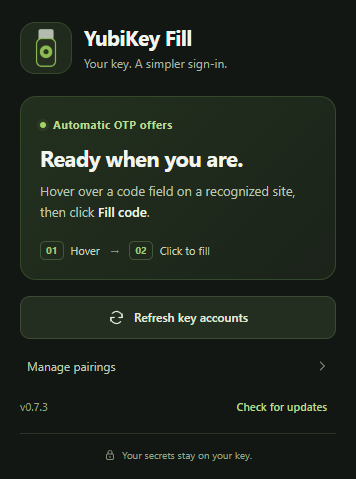

# YubiKey Fill

Hardware-backed OTP autofill for **Brave on Windows**. Your YubiKey calculates the code; the extension helps you use it on the matching login page.

**Experimental public preview.** This project has internal security tests and a documented review, but has not received an independent security audit. Release ZIPs have checksums and are currently unsigned. Review [the security policy](SECURITY.md) before using it with real accounts. This project is not affiliated with or endorsed by Yubico or Brave.



Hover over a supported code field to reveal the inline offer. See the code and time remaining, then click **Fill code**. Some websites verify automatically once all digits are entered; otherwise submit the form yourself. No per-site setup is needed for recognized providers with a unique matching account; multiple matches offer an account choice.

[Latest release](https://github.com/youval1234/brave-yubikey-fill/releases/latest) · [Privacy and security review](docs/SECURITY-REVIEW.md) · [Performance measurements](docs/PERFORMANCE.md)

## Features

- YubiKey-inspired popup and animated hover card, with reduced-motion support.
- Live TOTP preview and expiry countdown; expired previews refresh automatically.
- Exact-domain matching, foreground and document checks, and trusted-click filling.
- Existing OATH password and hardware-touch requirements remain enforced.
- Private-window support without saving new automatic site/account pairings.
- Event-driven page observation and on-demand styles to reduce idle work.
- Regional eBay/Amazon login domains and grouped six/eight-digit inputs, without IP or VPN-location checks.
- Optional GitHub release checks; no credentials bundled in the extension.

## Install

Requirements: Windows x64, Brave, Python 3.14 x64 with Tk, Windows .NET Framework, and a YubiKey with USB smart-card/CCID enabled. Keep Yubico Authenticator installed for managing the accounts on your key.

1. Download the **extension ZIP** and **source ZIP** from the release page and extract them. The extension ZIP contains `manifest.json` at its root; the source ZIP includes the Windows installer and helper source.
2. At `brave://extensions`, enable Developer mode and choose **Load unpacked**. Select the extracted extension folder.
3. Copy the extension ID shown by Brave. From the extracted source folder, run:

   ```powershell
   ./Install.ps1 -ExtensionId YOUR_EXTENSION_ID
   ```

4. Open a recognized HTTPS login page and hover over its OTP field. Click **Fill code** when offered. Touch or unlock the key if its existing policy requires it.

For private windows, enable **Details → Allow in Private** once in Brave. The browser controls this permission.

Only one YubiKey may be connected for a read. Account metadata is cached for up to one minute. **Refresh key accounts** optionally rereads that list after account changes; it is not a required sign-in step. Saved pairings pin the particular key and credential, so a different key does not silently replace an existing pairing. **Manage pairings** provides advanced manual configuration.

## Updates

Version **0.7.5** adds the MIT license to the project and both release packages, plus hardening of the development test helpers. OTP behavior and the native helper are unchanged.

Version 0.7.4 added regional marketplace matching and grouped digit boxes, including eBay's six-box layout. It uses the same helper as v0.7.3; no helper reinstall is needed for this update. See [regional support](docs/REGIONAL-SUPPORT.md).

Version 0.7.3 added **Check for updates**, release packaging and security hardening. That update checker needs the v0.7.3 Windows helper. Existing OTP filling does not require a GitHub sign-in.

The current in-app checker uses an installed GitHub CLI and its local sign-in (`gh auth login --hostname github.com`); run `Install.ps1` after installing the CLI. The installer records only the resolved CLI executable path. Authentication remains managed by GitHub CLI, outside the repository and browser extension. The public release page and downloads can also be opened directly without signing in; GitHub CLI is not needed for OTP filling.

Click **Check for updates** in the toolbar popup. It checks the latest published stable release only when clicked. If setup or access is unavailable, **View release on GitHub** opens the release page using your browser session.

This is an unpacked extension: the button checks and links to downloads; it does not install downloaded code. Replace files in the existing extension folder to preserve its ID, then reload it in Brave. Rerun the helper installer when release notes require it. [Browser update lifecycle](https://developer.chrome.com/docs/extensions/develop/concepts/extensions-update-lifecycle).

## Privacy and security

Normal OTP operations use local USB/Native Messaging only. Update checks use a fixed GitHub API endpoint through GitHub CLI; installation downloads hash-pinned packages from PyPI. The application does not send OTPs, account labels, device identifiers or website URLs to those services. Opening a release page is a normal GitHub navigation.

OTP seeds remain on the key. Account labels, key/credential identifiers and normal-window pairings are sensitive local metadata, stored in trusted extension storage; they are not encrypted vault data. Codes and passwords are transient. There is no app telemetry, clipboard use, analytics or password cache.

The matched website can read a code once filled. Treat a content-script preview as visible to that page's renderer; a closed shadow root is UI encapsulation, not a security boundary. A compromised legitimate site, compromised browser, or malware running as your Windows user is outside the protections this extension can provide. TOTP is not phishing-resistant like an origin-bound FIDO/passkey login.

Automatic offers need HTTPS site access. Matching uses exact known login hosts or an issuer explicitly naming an HTTPS origin; issuer labels are hints, not cryptographic proof of the service. Supported split inputs are one unambiguous, empty group of six/eight digit boxes with OTP semantics, plus eBay's named six-box layout. Unfamiliar providers, other custom controls and embedded frames may need adapters. See `extension/matching.js` for recognized hosts.

The repository, commit history and published releases are public. Report vulnerabilities through [private security reporting](https://github.com/youval1234/brave-yubikey-fill/security/advisories/new). Keep OTP seeds, recovery codes, personal screenshots, CLI authentication files and browser-profile data out of Git. Run `./Uninstall.ps1` to unregister the helper; remove the extension in Brave to clear its extension storage.

## Verification and release building

```powershell
node --test tests/extension.test.mjs tests/updates.test.mjs
python -B -m unittest discover -s tests
node tests/browser-smoke.mjs
python -B tools/privacy_audit.py --history
```

Run Python tests from an environment with `host/requirements.txt` installed. Browser tests use fresh isolated Brave profiles, intercepted fixture pages and dummy credentials; they make no live login attempt and remove their profiles afterward. `node tests/memory-smoke.mjs` measures approximate browser memory. Set `YUBIKEY_TEST_SCREENSHOT=1` to save a dummy preview at the fixed ignored path `.artifacts/screenshots/hover-preview.png`; the variable does not control the output filename.

After committing reviewed changes, run `python -B tools/build_release.py`. It archives only committed files into ignored `.artifacts/releases/VERSION/`, producing extension/source ZIPs and `SHA256SUMS.txt`. Scan those archives before uploading:

```powershell
python -B tools/privacy_audit.py --archive PATH_TO_EXTENSION_ZIP --archive PATH_TO_SOURCE_ZIP
```

The pattern scanner supplements manual review; it does not establish that a project is vulnerability-free. See [SECURITY.md](SECURITY.md) for disclosure guidance.

## License

Original project code, documentation and artwork are provided under the [MIT License](LICENSE), copyright 2026 youval1234. Third-party dependencies retain their own licenses. The license does not grant rights to Yubico or Brave trademarks or imply endorsement.
